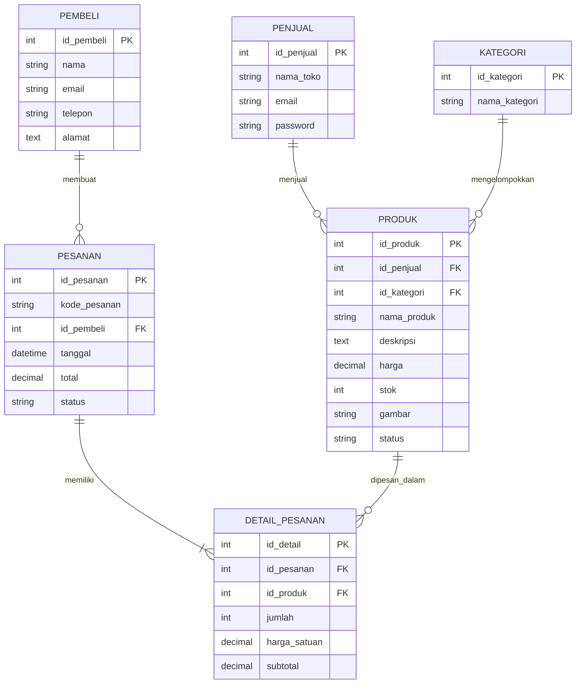
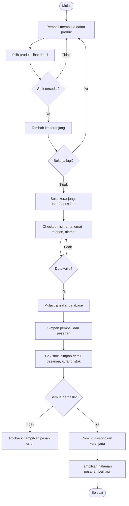

# Dokumen Perancangan Web Marketplace Tradisional

## A. Analisis dan Perancangan Sistem

### a. Identifikasi Entitas
| No | Entitas | Keterangan |
|----|---------|------------|
| 1 | Penjual | Pemilik toko yang login dan mengelola produk |
| 2 | Kategori | Pengelompokan produk |
| 3 | Produk | Barang yang dijual |
| 4 | Pembeli | Data pemesan saat checkout |
| 5 | Pesanan | Header transaksi pemesanan |
| 6 | Detail Pesanan | Rincian produk pada tiap pesanan |

### b. Rancangan Database Relasional
**penjual**: `id_penjual` (PK), nama_toko, email (unique), password (hash), created_at

**kategori**: `id_kategori` (PK), nama_kategori

**produk**: `id_produk` (PK), `id_penjual` (FK -> penjual), `id_kategori` (FK -> kategori), nama_produk, deskripsi, harga, stok, gambar, status, created_at

**pembeli**: `id_pembeli` (PK), nama, email, telepon, alamat, created_at

**pesanan**: `id_pesanan` (PK), kode_pesanan (unique), `id_pembeli` (FK -> pembeli), tanggal, total, status

**detail_pesanan**: `id_detail` (PK), `id_pesanan` (FK -> pesanan), `id_produk` (FK -> produk), jumlah, harga_satuan, subtotal

**Relasi**
- penjual 1 : N produk
- kategori 1 : N produk
- pembeli 1 : N pesanan
- pesanan 1 : N detail_pesanan
- produk 1 : N detail_pesanan
- (pesanan M : N produk diselesaikan oleh tabel detail_pesanan)

### c. ERD

(Tempel kode Mermaid di https://mermaid.live untuk mengekspor gambar ERD.)

### d. Alur Proses Transaksi


### e. Mockup UI
**Daftar Produk**
```
+--------------------------------------------------------------+
| Pasar Online                  [Keranjang (2)] [Login Penjual]|
+--------------------------------------------------------------+
| Daftar Produk                                                |
| [ Cari produk...        ] [ Semua kategori v ] [ Cari ]      |
| +--------+ +--------+ +--------+ +--------+                  |
| | gambar | | gambar | | gambar | | gambar |                  |
| | Nama   | | Nama   | | Nama   | | Nama   |                  |
| | Rp xxx | | Rp xxx | | Rp xxx | | Rp xxx |                  |
| |[Detail]| |[Detail]| |[Detail]| |[Detail]|                  |
| +--------+ +--------+ +--------+ +--------+                  |
+--------------------------------------------------------------+
```
**Detail Produk**
```
+--------------------------------------------------------------+
| < Kembali                                                    |
| +-----------------+  [Kategori]                              |
| |                 |  Nama Produk                             |
| |     gambar      |  Penjual: Toko ...                       |
| |                 |  Rp xxx                                  |
| +-----------------+  Deskripsi ...   Stok: 50                |
|                      [ 1 ] [ + Keranjang ]                   |
+--------------------------------------------------------------+
```
**Keranjang Belanja**
```
+--------------------------------------------------------------+
| Keranjang Belanja                                            |
| Produk      | Harga   | Jumlah        | Subtotal | Aksi      |
| Kopi 250g   | 45.000  | [2][Ubah]     | 90.000   | [Hapus]   |
| Kaos        | 85.000  | [1][Ubah]     | 85.000   | [Hapus]   |
|                                  Total: Rp 175.000           |
| [Lanjut Belanja]                            [Checkout]       |
+--------------------------------------------------------------+
```
